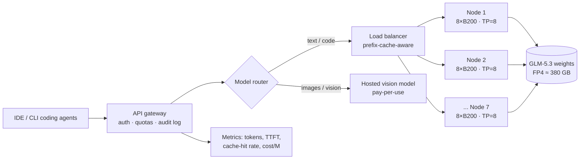
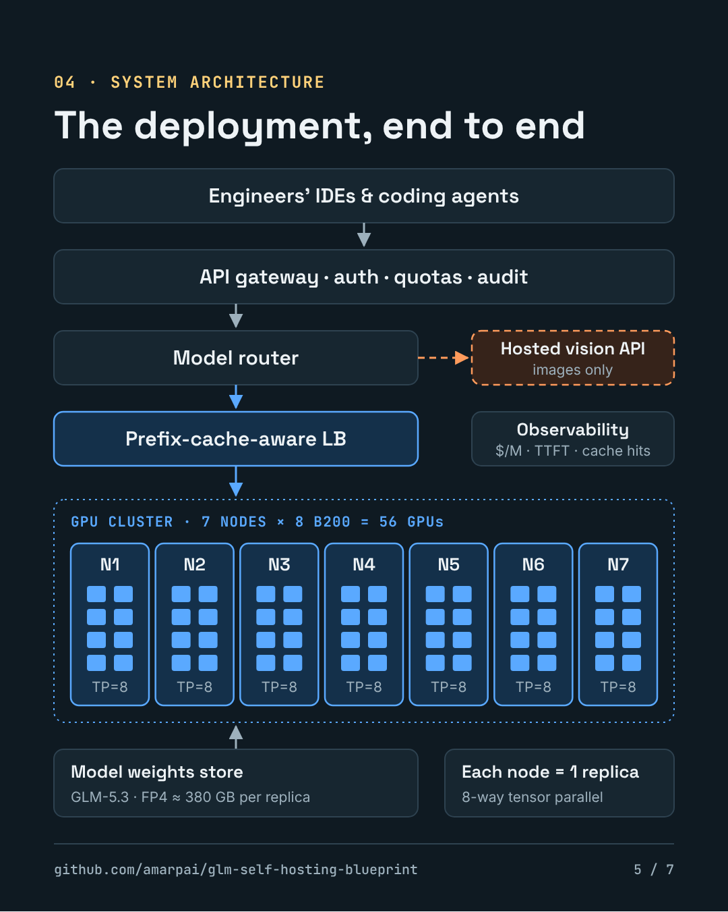

# GLM Self-Hosting Blueprint

A small, practical reference for running a large open-weight MoE model (GLM-5.3) on
your own GPUs for internal AI coding assistants, modelled on the architecture
**Revolut** has publicly described (reported November 2026).

> ⚠️ Revolut's figures below come from press and conference coverage, not from code
> Revolut published. The configs here are an **illustrative blueprint**, not Revolut's
> actual setup. Check model IDs, flags and licences against official docs before use.

## What Revolut reportedly did

| Item | Reported value |
|---|---|
| Users | ~2,000 engineers moved off hosted coding assistants |
| Model | GLM-5.1 at first, later GLM-5.3 (≈754B total / ≈40B active params, MoE) |
| Hardware | 56 × NVIDIA B200 (= 7 × 8-GPU nodes) |
| Context served | 256K (the model supports up to 1M) |
| Optimisations | FP4 weights, context-window cap, prefix/KV-cache reuse |
| Blended cost | ≈ $0.30 per million tokens |
| Outcome | ≈ 90% lower AI coding inference spend in under a year |
| Multimodal | GLM is text-only → a router sends image queries to hosted vision models |

## Reference architecture



Why each piece matters:

1. **One model replica per 8-GPU node.** FP4 weights (~380 GB) fit in one B200 node
   (8 × 192 GB) with room left for KV cache. Seven replicas scale horizontally.
2. **Cap the context.** Serving 256K instead of 1M cuts per-user KV memory, so more
   concurrent users fit per node and time-to-first-token drops.
3. **Prefix-cache-aware routing.** Coding agents resend the same system prompt and
   repo context. Sending a session back to the same replica turns repeat prefill
   into cache hits — the biggest throughput win for agent workloads.
4. **Hybrid routing.** Keep the 95%+ of traffic that is text/code on owned GPUs;
   pay per token only for the rare vision request.
5. **Measure cost per million tokens**, not GPU utilisation alone.

## Architecture diagrams (LinkedIn-ready)

[`docs/architecture.html`](docs/architecture.html) has seven SVG diagrams: business context,
data flow, processing pipeline, system architecture, cost levers and an adoption playbook.
They're exported at LinkedIn's 4:5 size (1080 × 1350) to
[`docs/linkedin/`](docs/linkedin/): one PNG per slide, plus
`glm-architecture-carousel.pdf` to upload as a LinkedIn document (carousel) post.



## Repo layout

```
deploy/   serving config for one 8-GPU node + docker-compose
router/   minimal model router (text → self-hosted, vision → external)
tools/    cost calculator: self-hosted vs. API pricing
docs/     LinkedIn post + adoption playbook for other companies
```

## Quick start

```bash
# 1. Estimate whether self-hosting pays off for YOUR usage
python3 tools/cost_calculator.py --engineers 2000 --tokens-per-engineer-day 2000000

# 2. Run the router locally (needs: pip install fastapi uvicorn httpx)
uvicorn router.router:app --port 8080
```

See [`docs/adoption-playbook.md`](docs/adoption-playbook.md) for how other companies
can apply this, and [`docs/linkedin-post.md`](docs/linkedin-post.md) for the post.

## Sources

- [The Register — Revolut slashes AI coding costs 10x](https://www.theregister.com/ai-and-ml/2026/11/03/british-fintech-revolut-slashes-ai-coding-costs-10x-by-cutting-out-claude-and-going-self-hosted/5307345)
- [Luca Berton — Revolut self-hosted GLM: 56 B200s at $0.30/M tokens](https://lucaberton.com/blog/revolut-self-hosted-glm-b200-ai-engineer-nyc-2026/)
- [Faraday Machines — case study](https://www.faradaymachines.com/revolut-self-hosted-glm-case-study/)
- [NVIDIA NIM — z-ai/glm-5.3 model card](https://docs.api.nvidia.com/nim/reference/z-ai-glm-5-3)
- [Z.ai docs — GLM-5.3-Flash](https://docs.z.ai/guides/vlm/glm-5.3-flash)
